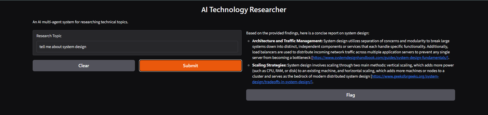
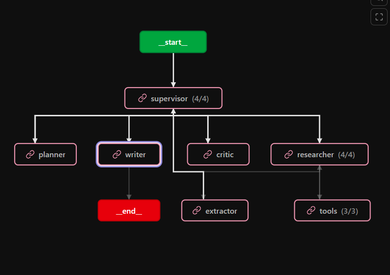
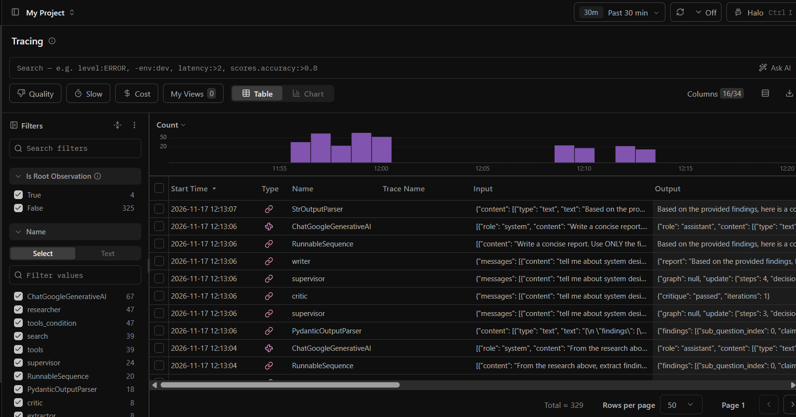

# AI Technology Researcher – Multi-Agent Research System

An AI-powered multi-agent research system designed to investigate technical topics, gather information from external sources, evaluate research findings, and generate structured reports.

Built using **LangGraph, MCP, FastAPI, Gradio, and Langfuse**.

## Overview

The AI Technology Researcher is a multi-agent system that automates technical research through a coordinated workflow of specialized AI agents.

Instead of relying on a single LLM to generate an answer, the system separates research into multiple stages, including planning, information gathering, evaluation, and report generation.

The system integrates MCP-based tools to access external information and uses Langfuse to monitor and trace agent execution.

A FastAPI backend exposes the research workflow through an API, while a Gradio interface provides a simple way to interact with the system.

## Key Features

- **Multi-Agent Architecture:** Uses specialized agents to divide research tasks into manageable stages.
- **Planning and Research:** Breaks down user queries and gathers relevant information.
- **MCP Integration:** Connects agents to external tools for web search and webpage retrieval.
- **Research Evaluation:** Uses a critic stage to evaluate research findings before report generation.
- **Automated Report Generation:** Produces structured reports from gathered information.
- **Observability:** Uses Langfuse to trace agent execution, LLM calls, and tool interactions.
- **REST API:** Exposes the research workflow through FastAPI.
- **Interactive Frontend:** Uses Gradio to provide a simple research interface.

## Architecture

The application follows a modular architecture with three main layers:

1. **Frontend:** Gradio interface for submitting research topics and viewing reports.
2. **Backend:** FastAPI handles HTTP requests and invokes the research service.
3. **AI Engine:** LangGraph orchestrates the multi-agent research workflow.


### Research Workflow

The research workflow consists of the following stages:

1. **Planning:** Analyzes the user's query and develops a research plan.
2. **Research:** Investigates the planned topics using available MCP tools.
3. **Critique:** Evaluates the gathered findings and identifies potential gaps.
4. **Report Generation:** Synthesizes the research findings into a structured report.

The workflow is orchestrated using LangGraph.

## Tech Stack

| Category | Technologies |
|---|---|
| Programming Language | Python |
| Agent Orchestration | LangGraph |
| LLM Integration | LangChain, Google Gemini |
| Tool Integration | Model Context Protocol (MCP) |
| Web Search | DuckDuckGo MCP Server |
| Web Retrieval | Fetch MCP Server |
| Backend | FastAPI |
| Frontend | Gradio |
| Observability | Langfuse |
| Dependency Management | uv |

## Project Structure

```text
multi-agent-system/
│
├── src/
│   └── multi_agent_system/
│       ├── agents/
│       ├── client.py
│       ├── config.py
│       ├── graph.py
│       ├── main.py
│       ├── prompts.py
│       ├── state.py
│       └── tracing.py
│
├── app/
│   ├── api/
│   │   └── routes.py
│   ├── schemas/
│   │   └── research_schema.py
│   ├── services/
│   │   └── research_service.py
│   └── main.py
│
├── frontend/
│   └── gradio_app.py
│
├── docs/
│
├── .env.example
├── pyproject.toml
└── README.md
```

## Application Screenshots

### Gradio Interface



### Execution-flow




## Observability

Langfuse is integrated to monitor the execution of the multi-agent workflow.

It provides visibility into:

- Agent execution traces
- LLM interactions
- Tool calls
- Execution flow
- Latency and token usage (where available)



## Future Improvements

- Add persistent storage for research reports.
- Implement research history and session management.
- Improve evaluation of research quality and source reliability.
- Add support for additional research tools and data sources.
- Containerize the application using Docker.
